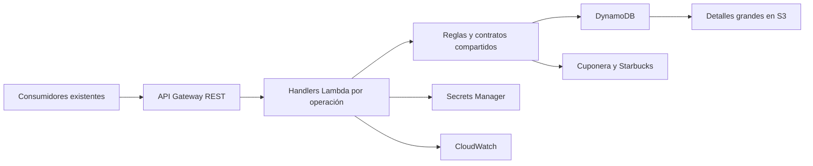

# Middleware Cuponera en AWS

Backend HTTP con **Node.js 24, TypeScript, ESM nativo y AWS SDK v3 modular**, basado en el código Java Cuponera. Serverless Framework **3.40.0** aprovisiona API Gateway REST Regional, seis Lambdas, DynamoDB, S3, Secrets Manager, IAM y CloudWatch mediante `serverless.yml`.



## Desarrollo y comprobaciones

Ejecutar los comandos desde la raíz del repositorio. Requisitos: Node.js 24 y npm; la verificación completa requiere además `unzip` para inspeccionar paquetes. No se necesita Java, Docker ni acceso AWS para ejecutar las pruebas locales.

### Comprobación mínima sin instalar nada

Con las dependencias ya presentes en `node_modules`:

```sh
node --version
npm run typecheck
npm test
```

`node --version` debe mostrar `v24.x.x`. `typecheck` detecta errores de tipos TypeScript sin generar archivos. `npm test` compila el proyecto y ejecuta las pruebas locales con `node:test`, por lo que no hace falta ejecutar `build` aparte.

Para comprobar únicamente la compilación y generar `dist/`:

```sh
npm run build
```

Estos comandos no instalan dependencias. Si falta `node_modules` o alguna dependencia necesaria, no se podrá completar la compilación ni las pruebas sin instalarla previamente.

### Verificación completa

Con los mismos requisitos y `unzip`, ejecutar:

```sh
npm run verify
```

`verify` comprueba tipos, ejecuta pruebas Node.js, empaqueta con Serverless y carga cada ZIP como ESM en Node.js 24. Verifica runtime, top-level await, SDK, protección de datos y ausencia de compiladores TypeScript en los artefactos. Después prueba los handlers con el SDK v3 real sobre un servidor local y bloquea salida de red externa. No despliega ni llama a AWS.

Superar estas comprobaciones valida los casos cubiertos localmente; no garantiza ausencia absoluta de errores ni valida las integraciones reales en AWS.

La comprobación de seguridad es independiente y consulta la auditoría de npm:

```sh
npm run audit:dependencies
```

`audit:dependencies` audita todas las dependencias y falla mientras existan avisos conocidos. Último estado registrado: 15 paquetes afectados, cero críticos; producción sin avisos. El despliegue exige esta comprobación y un manifiesto SHA-256 del artefacto verificado. Consultar [saneamiento y bloqueos](docs/dependency-remediation.md) y [compatibilidad HTTP](docs/http-parity.md).

Si se necesita preparar un clon sin dependencias, el siguiente paso **sí instala paquetes** y queda fuera de las comprobaciones sin instalación:

```sh
npm ci --ignore-scripts
```

Los comandos de empaquetado y despliegue cargan un adaptador ESM de interfaces de terceros con hashes fijados. Para otros comandos del CLI usar `npm run serverless -- <comando>`; no invocar directamente el binario ni una instalación global.

| Comando | Propósito |
| --- | --- |
| `npm run typecheck` | Comprobación TypeScript sin emitir código. |
| `npm test` | Compilación previa y pruebas con `node:test`. |
| `npm run build` | Transpilación a `dist/` y preparación de Swagger UI. |
| `npm run package` | Empaquetado dev, sin aprovisionamiento. |
| `npm start` | Servidor local con memoria e integraciones simuladas. |
| `npm run baseline -- --source /ruta/Cuponera` | Huellas y ubicaciones sensibles, sin copiar valores ni ejecutar Java. |
| `npm run deploy -- --stage dev --config /ruta/deployment.json` | Comprobaciones de cuenta/configuración y empaquetado; sin desplegar. |

Para el servidor local, definir `LOCAL_CLIENT_ID` y `LOCAL_CLIENT_SECRET`. Se genera una clave de firma efímera por proceso. No se muestran credenciales en consola. Escucha exclusivamente en `127.0.0.1:8080`; sus tokens y datos se pierden al reiniciarlo.

## Contratos

Se conservan `POST /auth/token`, `GET /coupons/healthcheck`, `POST /coupons/validate`, `POST /coupons/redeem`, `POST /coupons/generate`, `GET /coupons/transaction/latest` y `GET /test-insights`, además de Swagger/OpenAPI.

JWT conserva interpretación Base64, HMAC y `iat = exp`. Canjear devuelve HTTP 200 con `status: 201` en el cuerpo. `transaction/latest` consulta exclusivamente validaciones pendientes. Consultar [compatibility.md](docs/compatibility.md).

## Despliegue y configuración

Entornos: dev, qa, prod; región us-east-1. Copiar [deployment.example.json](config/deployment.example.json) a una ubicación de trabajo y sustituir cuenta y configuración no sensible. Las URLs `.invalid` se rechazan antes del despliegue.

El comando protegido comprueba la cuenta y conserva el rol regional existente de logs de API Gateway. Un despliegue real requiere `--execute`:

```sh
npm run deploy -- --stage dev --config /ruta/deployment.json --execute
```

Antes de usarlo, revisar permisos, CloudTrail, configuración y artefactos. No se ha realizado ningún despliegue durante la implementación.

Secrets Manager crea contenedores vacíos: el propietario debe cargar sus versiones antes de habilitar tráfico. Las Lambdas solo reciben ARN. Consultar [secrets.md](docs/secrets.md).

Tablas, detalles, claves y secretos se retienen al eliminar o reemplazar recursos. Producción protege la tabla contra eliminación. El rol de logs de API Gateway es compartido por cuenta/región; el despliegue protegido reutiliza el existente.

## Migración y operación

- [migration.md](docs/migration.md): importación, conciliación, corte y recuperación.
- [operations.md](docs/operations.md): logs, métricas, alarmas y carga.
- [verification.md](docs/verification.md): alcance y comprobaciones pendientes.
- [review.md](docs/review.md): revisión detallada, correcciones y riesgos pendientes de herramientas de desarrollo y aceptación productiva.
- [Decisiones](.agents/decisions/README.md) y [contexto para agentes](AGENTS.md).

La referencia Java se analizó **solo estáticamente**, conforme a la instrucción del usuario. No se descargó JDK 21 ni se ejecutó Java tras esa instrucción. Las pruebas derivadas del código no constituyen una certificación diferencial contra el servicio Java desplegado ni contra proveedores reales.
