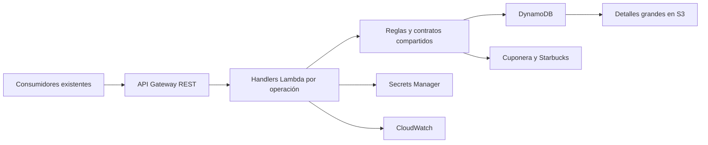

# Middleware Cuponera en AWS

Backend HTTP con **Node.js 24, TypeScript, ESM nativo y AWS SDK v3 modular**, basado en el código Java Cuponera. Serverless Framework **3.40.0** aprovisiona API Gateway REST Regional, seis Lambdas, DynamoDB, S3, IAM y CloudWatch; consume el secreto externo administrado por DevOps mediante `serverless.yml`.



## Desarrollo y comprobaciones

Ejecutar los comandos desde la raíz del repositorio. Requisitos: Node.js 24 y npm; la verificación completa requiere además `unzip` para inspeccionar paquetes. No se necesita Java, Docker ni acceso AWS para ejecutar las pruebas locales.

### Comprobación mínima sin instalar nada

Con las dependencias ya presentes en `node_modules`:

```sh
node --version
npm run typecheck
npm test
```

`node --version` debe mostrar `v24.x.x`. `typecheck` detecta errores de tipos TypeScript sin generar archivos. `npm test` compila el proyecto y ejecuta las pruebas locales con `node:test`, por lo que no hace falta ejecutar `build` aparte.

Para comprobar únicamente la compilación y generar `dist/`:

```sh
npm run build
```

Estos comandos no instalan dependencias. Si falta `node_modules` o alguna dependencia necesaria, no se podrá completar la compilación ni las pruebas sin instalarla previamente.

### Verificación completa

La verificación completa requiere además Python >=3.10 y <3.15 para cfn-lint. Preparar una vez el entorno aislado (instala herramientas desde PyPI):

```sh
npm run setup:infra-lint
```

Con las herramientas preparadas, ejecutar:

```sh
npm run verify
```

`verify` ejecuta ESLint sobre JavaScript propio, comprueba tipos, ejecuta pruebas Node.js, empaqueta con Serverless, valida la plantilla con cfn-lint y carga cada ZIP como ESM en Node.js 24. Verifica runtime, top-level await, SDK, protección de datos y ausencia de compiladores TypeScript en los artefactos. Después prueba los handlers con el SDK v3 real sobre un servidor local y bloquea salida de red externa. No despliega ni llama a AWS.

TypeScript 7.0.2 permanece bajo `tsc`; no se instala `typescript-eslint` mientras no declare compatibilidad. Alcance, instalación y advertencias en [análisis estático](docs/code-quality.md).

Superar estas comprobaciones valida los casos cubiertos localmente; no garantiza ausencia absoluta de errores ni valida las integraciones reales en AWS.

La comprobación de seguridad es independiente y consulta la auditoría de npm:

```sh
npm run audit:dependencies
```

`audit:dependencies` audita todas las dependencias y falla mientras existan avisos conocidos. Última auditoría (2026-10-23): 10 paquetes afectados (9 altos y 1 bajo), cero críticos; producción sin avisos. El despliegue exige esta comprobación y un manifiesto SHA-256 del artefacto verificado. Consultar [saneamiento y bloqueos](docs/dependency-remediation.md) y [compatibilidad HTTP](docs/http-parity.md).

Si se necesita preparar un clon sin dependencias, el siguiente paso **sí instala paquetes** y queda fuera de las comprobaciones sin instalación:

```sh
npm ci --ignore-scripts
```

Los comandos de empaquetado y despliegue cargan un adaptador ESM de interfaces de terceros con hashes fijados. Para otros comandos del CLI usar `npm run serverless -- <comando>`; no invocar directamente el binario ni una instalación global.

| Comando | Propósito |
| --- | --- |
| `npm run lint` | ESLint sobre scripts, plugins y configuración ESM propia. |
| `npm run lint:infra` | Valida la plantilla CloudFormation ya empaquetada; errores bloqueantes y advertencias en `.cache/quality/cfn-lint.json`. |
| `npm run typecheck` | Comprobación TypeScript sin emitir código. |
| `npm test` | Compilación previa y pruebas con `node:test`. |
| `npm run build` | Transpilación a `dist/` y preparación de Swagger UI. |
| `npm run package` | Empaquetado dev, sin aprovisionamiento. |
| `npm start` | Servidor local con memoria e integraciones simuladas. |
| `npm run baseline -- --source /ruta/Cuponera` | Huellas y ubicaciones sensibles, sin copiar valores ni ejecutar Java. |
| `npm run deploy -- --stage dev --config /ruta/deployment.json` | Comprobaciones de cuenta/configuración y empaquetado; sin desplegar. |

Para el servidor local, definir `LOCAL_CLIENT_ID` y `LOCAL_CLIENT_SECRET` y exportar el archivo antes de arrancar (`.env` no se carga automáticamente):

```sh
set -a; source .env; set +a; npm start
``` LOCAL_CLIENT_SECRET debe tener al menos 48 bytes UTF-8 y se reutiliza para firmar JWT. No se muestran credenciales en consola. Escucha exclusivamente en `127.0.0.1:8080`; los datos se pierden al reiniciarlo; los JWT mantienen su validez temporal mientras se conserve la misma credencial local.

## Contratos

Se conservan `POST /auth/token`, `GET /coupons/healthcheck`, `POST /coupons/validate`, `POST /coupons/redeem`, `POST /coupons/generate`, `GET /coupons/transaction/latest` y `GET /test-insights`, además de Swagger/OpenAPI.

JWT conserva interpretación Base64, HMAC y `iat = exp`. Canjear devuelve HTTP 200 con `status: 201` en el cuerpo. `transaction/latest` consulta exclusivamente validaciones pendientes. Consultar [compatibility.md](docs/compatibility.md).

## Despliegue y configuración

La infraestructura declarativa está en `infra/**/*.yml`, referenciada desde `serverless.yml`. El principal centraliza las variables Lambda, parámetros por entorno y referencia al secreto único. Consulta el [análisis de infraestructura y mapeo del Java](docs/serverless-infrastructure.md). Solo la URL activa de generación stage se configura en dev; los endpoints comentados del Java permanecen como referencia documental; los valores ausentes usan `REPLACE_ME` y dominios `.invalid`, que deben sustituirse antes de integrar.

Entornos: dev, qa, prod; región us-east-1. Copiar [deployment.example.json](config/deployment.example.json) a una ubicación de trabajo y sustituir cuenta y configuración no sensible. Las URLs `.invalid` se rechazan antes del despliegue.

El comando protegido comprueba la cuenta y conserva el rol regional existente de logs de API Gateway. Un despliegue real requiere `--execute`:

```sh
npm run deploy -- --stage dev --config /ruta/deployment.json --execute
```

Antes de usarlo, revisar permisos, CloudTrail, configuración y artefactos. No se ha realizado ningún despliegue durante la implementación.

DevOps administra un único secreto externo: `cuponera-api-security/dev/aws-mdw` en dev. Las Lambdas reciben `SECURITY_SECRET_ID` y reutilizan sus campos con caché. El stack no crea secretos ni una clave KMS. QA/prod usan nombres independientes por entorno mediante `securitySecretName`; `securitySecretKmsKeyArn` permite declarar la clave KMS externa cuando corresponda. Consultar [secrets.md](docs/secrets.md) y la [revisión detallada](docs/single-secret-review.md).

El despliegue protegido conserva parámetros vacíos mediante una configuración pública temporal con --config nativo de Serverless 3; se elimina al terminar o fallar y no modifica serverless.yml. Los valores del archivo público deben ser literales.

Tablas y detalles se retienen al eliminar o reemplazar recursos. DevOps administra el ciclo de vida del secreto externo y su clave. Producción protege la tabla contra eliminación. El rol de logs de API Gateway es compartido por cuenta/región; el despliegue protegido reutiliza el existente.

## Migración y operación

- [migration.md](docs/migration.md): importación, conciliación, corte y recuperación.
- [operations.md](docs/operations.md): logs, métricas, alarmas y carga.
- [serverless-quality-review.md](docs/serverless-quality-review.md): revisión detallada de la modularización y controles, con hallazgos corregidos y límites.
- [verification.md](docs/verification.md): alcance y comprobaciones pendientes.
- [review.md](docs/review.md): revisión detallada, correcciones y riesgos pendientes de herramientas de desarrollo y aceptación productiva.
- [Decisiones](.agents/decisions/README.md) y [contexto para agentes](AGENTS.md).

## Sincronización con GitLab

El flujo de integración continua incluye la acción `.github/workflows/sync-gitlab.yml` que sincroniza las ramas hacia el repositorio de GitLab: `https://gitlab.com/grp-alsea/sgrp-cuponera/prj-cuponera-back-mdw-sls.git`.

Para configurar la autenticación:
1. Ir a la configuración del repositorio en GitHub (`Settings` > `Secrets and variables` > `Actions`).
2. Crear un secreto con el nombre `GITLAB_TOKEN` y asignar como valor el Personal Access Token de GitLab con permisos de escritura.

La referencia Java se analizó **solo estáticamente**, conforme a la instrucción del usuario. No se descargó JDK 21 ni se ejecutó Java tras esa instrucción. Las pruebas derivadas del código no constituyen una certificación diferencial contra el servicio Java desplegado ni contra proveedores reales.
